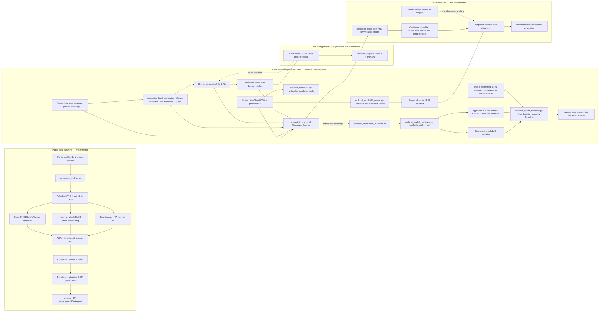

# AIMA Architecture

**Status snapshot:** 2026-10-12. This document distinguishes runnable code, generated research artifacts, small experiments, and protocol proposals. For non-negotiable rules, see [ARCHITECTURE_ESSENTIALS.md](ARCHITECTURE_ESSENTIALS.md).

## System view

Dashed links show the original candidate flow. The legacy public feature extractor uses ImageNet weights. Independent Experiment 3 now implements public-anemia pretraining and local neural adaptation; its verified negative transfer result is documented below.

## 1. Public-data pipeline

| Stage | Implementation and behavior | Status / limitation |
|---|---|---|
| Inputs | `data/raw/dataset anemia/<country>/`: workbook columns `Number`, `Hgb`, `Gender`, `Age`; image folders include `_palpebral.png` and matching full `.jpg`. | Implemented for the public archive. The loader ignores names containing `_forniceal_`. |
| Cohort row | `src/dataset_builder.py` joins by `(country, numeric subject_id)`, derives the binary label using `<12 g/dL` for `F`, otherwise `<13 g/dL`, and emits one row per eligible palpebral image. | Implemented legacy/public policy; do not assume it is the local WHO label policy. |
| Color features | `src/preprocess.py` uses OpenCV BGR-to-8-bit-LAB and returns mean/std for L*, a*, b* after numeric rescaling. | Implemented. Inputs are not color-calibrated; the fixed ROI raster may include background/padding in its statistics. |
| Image features | `src/feature_extractor.py` resizes to 224×224, ImageNet-normalizes, and extracts a frozen 576-value MobileNetV3-Small embedding with ImageNet weights. | Implemented as feature extraction, not fine-tuning. |
| ITA | `dataset_builder.py` calculates one ITA value from a fixed bottom-left margin patch of the paired full-face JPEG. | Implemented but not validated as a standardized skin-tone measurement protocol. |
| Classifier | `src/train_classifier.py` trains LightGBM binary GBDT on the six LAB statistics, 576 embeddings, and one ITA value (583 features); threshold is 0.5. | Implemented. It uses `StratifiedKFold` by row, not a group-aware splitter. Current table has 184 unique `(country, subject_id)` rows; this does not establish external or repeated-image generalization. |
| Evaluation | `src/evaluate.py` computes classification metrics and ITA subgroups/one-way ANOVA; `src/reproduce_public_baseline.py` validates and reproduces the baseline. | Implemented. Current mean-of-fold results: accuracy 80.41%, sensitivity 76.90%, specificity 82.73%, ROC-AUC 0.8723. These are internal CV estimates. Very small ITA subgroups make fairness conclusions underpowered. |
| Outputs | `data/processed/dataset.csv`, `results/cross_validation_predictions.csv`, `results/feature_gain_importance.csv`, and dated reproduction outputs under `data/processed/public_baseline_reproduction_2026-10-07/`. | Generated files are local research artifacts; keep private/ignored as configured. |

Public baseline flow is eyelid-only. It uses a public segmented ROI and a full-image-derived ITA; it is not a nail or paired local model.

## 2. Local data, cohort, and annotations

### Sources and linkage

- Frozen source: `data/raw/local/metadata/frozen_2026-10-07/AIMA Patients Metadata - Sheet1 values.csv`; observed mtime `2026-10-07T14:55:39+08:00`, SHA-256 `1e704fb8d575757f16fc4f690cdc3315bc4063a5cf258d6c2e1b5f784d19596d` (also recorded in its provenance JSON and derived manifests). The export contains 140 subjects and 275 image references (140 eyelid, 135 nail). All referenced originals passed the recorded unique-resolution audit in `data/raw/local/incoming/`; five subjects have no nail reference in the metadata.
- Original DNG/HEIC/JPEG/PNG files remain unchanged under ignored `incoming/`. Black subject-ID cards are identity aids only, not model inputs. TIFFs under `annotations/` are derived annotation copies.
- `subject_id`, modality, the exact original filename, source path, annotation-copy path, ROI/mask path, and hashes are joined by the frozen subject manifest and `annotations/manifests/annotation_manifest.csv`. Never rely on a TIFF basename alone as the clinical subject link.

### Metadata and label generation

- `src/local_metadata.py` creates an unlabeled candidate table from the frozen subject manifest; it does not infer anemia labels.
- `src/local_who2024_cohort.py` checks the frozen CSV against its hash/provenance and validates schema, IDs, Hb fields, age/sex, and image links before deriving a cohort. The configured adult non-pregnant rule is strict `<13.0 g/dL` for M and `<12.0 g/dL` for F, with age 15–65. The source Hb field/value is retained; normalized g/dL and the derived label are additional fields. The Sheet does not record pregnancy status; the run requires an explicit owner attestation, which the project owner has supplied.
- Current generated summary: 119 eligible/labeled subjects (19 anemia, 100 non-anemia); 21 excluded (20 without laboratory Hb and one outside the configured age range). A ten-fold subject assignment is generated with seed `20261007` in `data/processed/local_cohort_who2024_2026-10-08/subject_folds.csv`. This is a prepared split artifact, not evidence that local model training or validation has run.
- Eligibility is subject-level; modality availability is separate (119 eyelid, 114 nail, 114 paired). Missing nails do not remove eyelid-eligible subjects.

### Manual annotations and quality status

- `data/raw/local/annotations/` is the only active annotation workspace. Its current manifest links image references with source and annotation filenames. The manifest builder uses a registered `image_ready_inventory.csv` snapshot; it does not discover new files automatically.
- Current inventory: 275 annotation TIFFs (140 eyelid, 135 nail); the canonical annotation manifest now records 150 approved manual Fiji ROI + binary-mask pairs (140 eyelid, 10 nail). They pass filename/subject, hash, geometry, nonempty, and binary checks. The study owner reviewed the 140 eyelid anatomical contact sheets on 2026-10-09; 118 masks were newly rasterized and 22 identical existing masks were reused. This is annotation QC, not clinician validation. The pending queue now has 125 fingernail images and no eyelid images. The 2026-10-08 WHO cohort artifact remains a historical snapshot with its earlier 32-mask inventory; regenerate a versioned cohort output before relying on its mask-count files.
- `src/render_local_annotation_tiffs.py` staged the 125 previously missing nail TIFFs in `annotations/pending/nail/images/`: 121 from oriented, full-resolution embedded DNG JPEG previews and four from macOS ColorSync HEIC-to-sRGB renders. The TIFFs are 8-bit RGB with lossless Deflate compression and horizontal predictor 2. The DNG preview pixel method matches the ten existing pilot nail TIFFs. Those previews declare Display P3 while the pilot TIFFs carry an sRGB ICC tag; these annotation copies must not be treated as calibrated or uniform-color model inputs. Per-image methods, hashes, and dimensions are retained in the ignored TIFF-render provenance report and image inventory.
- Manual ROI is the ground-truth annotation source. The exposed palpebral conjunctiva and visible nail plate are separately annotated. Glare is tracked independently. The ten nail HSV glare candidates were rejected as overinclusive; the Batch 1 eyelid glare rules remain pilot candidates and are not clinically validated. Do not use either as anatomical labels or accepted glare exclusions.
- `src/local_annotation_manifest.py` validates/registers files and creates the queue; it does not draw labels. The local eyelid classifier's preparation command now consumes the approved manual masks for six LAB statistics, under the explicitly recorded exploratory input policy below.

## 3. Local segmentation experiment

`src/segmentation_prototype.py` is an exploratory per-modality ExtraTrees pixel classifier using RGB/HSV/LAB, blurred-color and position features. It downsizes to a maximum side of 768, trains on 8 manually labeled subjects and validates on 2 per fold, rotating over 10 pilot subjects (5-fold subject-held-out). It saves proposals and overlays under ignored `data/processed/segmentation_prototype_2026-10-07/`.

Observed pilot averages: eyelid Dice 0.694 / IoU 0.555 (minimum Dice 0.320); nail Dice 0.746 / IoU 0.602 (minimum Dice 0.539). This small test is not a production acceptance study; visual failures include anatomical leakage. Three unseen proposals per modality have no ground-truth metric. Proposals require human correction/review and never replace the manual ROI/mask.

### Public-trained eyelid U-Net transfer check (2026-10-09)

`src/local_segmentation_pilot.py` applies the existing Eyes Defy Anemia MobileNetV3-Small U-Net checkpoint to approved local eyelid TIFFs without local training. The full-frame development run covered 111 subject-disjoint train/validation references (80 train, 31 validation); it did not score the 29 preallocated local test subjects. Mean Dice/IoU/precision/recall were 0.0027/0.0014/0.0021/0.0075. 110/111 predictions triggered at least one basic QC flag. Mean inference time was 0.073 s/image on CPU; mean OpenCV-LAB mean-color delta was 22.60 (uncalibrated and only a rendering-dependent diagnostic).

This is strong evidence that the public-only model is not suitable for unattended local eyelid segmentation. Its predicted masks remain unverified proposals and do not modify the 140 reviewed local masks. Test subjects were not used for this development comparison; use the reserved subject set only for a final comparison after local model selection. Outputs, split ledger, and prediction metadata are private under `data/processed/segmentation/local_unet_dev_eval_fullframe_2026-10-09/`.

### Fingernail SAM 2.1 pilot (2026-10-09)

`src/sam2_nail_segmentation.py` trains a separate ExtraTrees pixel prompt model from the ten approved nail masks, then supplies a coarse-mask-derived box and positive/negative points to Meta SAM 2.1 Hiera Tiny. Leave-one-subject-out evaluation excludes each target subject from its prompt-model fold. Mean Dice/IoU/precision/recall were 0.794/0.669/0.680/0.987 across ten subjects, versus 0.737/0.591/0.638/0.943 for the ExtraTrees prompt mask alone. SAM averaged 0.578 seconds per image on MPS (1.169 seconds for the full prompt pipeline). The mean reference-versus-prediction CIELAB mean delta was 7.51 in OpenCV's current 8-bit encoding; it is uncalibrated and only a within-rendering diagnostic.

The small held-out pilot suggests SAM may help reduce tracing, but the high recall/moderate precision and visual boundary leakage mean it is not a reliable hands-off annotator. A separate batch has predictions for 116 unannotated nails; 21 have an area-range attention flag and all 116 remain `predicted_unverified`. The 95 unflagged cases are not presumed correct. No prediction entered the canonical annotation manifest or approved-mask folder. See [the pilot report](../experiments/sam2-nail-pilot-2026-10-09.md) for the local artifact paths and review limits. Eyelid annotation remains manual.

## 4. Local anemia model: completed exploratory experiment

The manual-eyelid LAB classifier completed fixed five-fold subject cross-validation on 2026-10-10 after the owner confirmed every similarity candidate as a distinct source. Results are internal development estimates, with no untouched classifier holdout or external validation. The 2026-10-08 cohort output records `training_status=not_run_insufficient_reviewed_positive_masks` based on its then-current inventory; this is historical wording. Its builder also assumes a nonempty annotation shortlist, so it cannot safely refresh the now-complete eyelid inventory. The separate readiness command produces new versioned artifacts without modifying that cohort or its label policy.

### Fixed local eyelid experiment (2026-10-10)

- **Owner decisions:** the owner delegated rendering/model choices and explicitly selected all 119 labeled subjects for classifier development. The selected design uses five subject folds with seed `20261010`; there is no classifier holdout. The old segmentation split ledger is preserved and is not used as a classifier partition.
- **Verified inputs:** the new read-only audit recomputed 140 approved eyelids and 119 eligible labeled inputs (19 anemia, 100 non-anemia), with 21 exclusions (20 missing laboratory Hb, one outside the configured age range). Every eyelid passed source/TIFF/ROI/mask hashes, human-register linkage, binary geometry, and equality with the mask pixels shown in the review package. Approval is anatomical review, not clinician validation. Non-pregnancy remains an owner attestation outside the Sheet.
- **Rendering and features:** `extract_masked_lab` uses the unchanged stored RGB TIFF arrays, interprets them as sRGB for OpenCV's quantized 8-bit LAB conversion, rescales L to 0–100 and a/b by subtracting 128, and computes mean/population standard deviation only inside the approved anatomical mask. No crop, resize, background filling, color-profile transform, enhancement, or glare exclusion is applied. All anatomical pixels, including glare, remain selected. These are uncalibrated, rendering-dependent features. The histories comprise 99 Photos exports, 18 Preview/ColorSync renders, 11 embedded DNG-preview copies, and 12 pilot exports with unrecorded settings. A matching sRGB tag does not make those histories uniform.
- **Models and metrics:** fixed L2 logistic regression (`C=1`, `lbfgs`, 2,000 maximum iterations, no class weighting) with a training-fold-only `StandardScaler`, compared with `DummyClassifier(strategy="most_frequent")`. No tuning, CNN fitting, embedding extraction, LightGBM, ITA, demographic, or Hb predictors are included. Evaluation code supports accuracy, sensitivity, specificity, precision, F1, confusion matrices, ROC-AUC, average precision and trapezoidal PR-AUC. The fixed 0.5 classification rule is a research threshold, with no clinical operating claim. Wilson proportion intervals and stratified subject bootstraps are conditional on OOF predictions; they do not include model-refit uncertainty or establish external validation.
- **Partitions:** newly prepared folds 1–4 each contain 4 anemia/20 non-anemia subjects, and fold 5 contains 3/20. Both classes are present in every training/validation fold. One record per subject is enforced; repeated-image aggregation would require a separate decision. The old ten-fold table has 2/10 in folds 1–9 and 1/10 in fold 10 and remains a historical audited reference.
- **Cleared training gate:** source and decoded-pixel exact-duplicate groups are zero. The 46 full-frame pHash candidates were reproduced; 28 cross the new classifier folds (27 cross the old folds and 34 cross segmentation partitions). The owner reviewed them and confirmed all as nonduplicates in the current chat. `duplicate_review_confirmed_2026-10-10.csv` records `distinct_sources` for every hash-linked candidate; the verbatim owner statement is preserved in a private confirmation JSON. No image or subject was deleted, merged, or reassigned. A fresh audit matched the prepared inputs and all source hashes; `gate_release_2026-10-10.json` records the separate review clearance. Future uncertain or confirmed duplicates still stop fitting.
- **Observed pooled OOF results:** LAB logistic accuracy 84.9%, sensitivity 10.5% (2/19; Wilson 95% interval 2.9–31.4%), specificity 99.0%, precision 66.7%, F1 0.182, ROC-AUC 0.719 (conditional 95% interval 0.576–0.839), average precision 0.388, and trapezoidal PR-AUC 0.375. Confusion matrix, rows/columns ordered non-anemia/anemia: `[[99, 1], [17, 2]]`. Majority baseline accuracy 84.0%, sensitivity 0%, specificity 100%, undefined precision, F1 0, ROC-AUC 0.500, AP 0.160, and trapezoidal PR-AUC 0.580; matrix `[[100, 0], [19, 0]]`. The majority trapezoidal area reflects interpolation to the precision=1 endpoint, not useful discrimination. The LAB model missed 17 of 19 positive subjects at the fixed research threshold; accuracy alone is misleading. Fold ROC-AUC ranged from 0.425 to 0.950. No threshold, model, parameter, or fold was changed from these results.
- **Artifacts and verification:** preparation remains in `data/processed/local_eyelid_readiness_2026-10-10_v2/`; its historical audit/config and blank review template are preserved alongside the confirmed review and gate release. The earlier `v1` preparation snapshot is retained. Completed outputs are in `data/processed/local_eyelid_classification_2026-10-10_v1/`: ten fold models, 119 private OOF prediction rows, pooled/per-fold metrics and conditional intervals, configuration/source/fold/review evidence, execution logs, aggregate figures, and a report. `metrics.json`, `run_manifest.json` and `verification.json` record current completion; copied preparation files retain their historical pending status. All 31 synthetic tests passed. Post-run verification reproduced every prediction from the saved models, checked training-only scaler statistics, convergence, subject exclusivity and provenance, and independently recalculated pooled metrics. These checks do not establish clinical validity.

See [the local eyelid classifier guide](../experiments/local-eyelid-classifier.md) for commands, review requirements, and limitations.

When data are ready, keep distinct experiments:

1. **Eyelid-only:** all eligible subjects with reviewed eyelid inputs; nail availability is irrelevant.
2. **Nail-only:** eligible subjects with reviewed nail inputs; state its different sample size and class support.
3. **Paired:** subjects with both modalities and valid reviewed inputs. Do not silently impute or treat a single modality as paired.

Within each experiment, fit preprocessing/feature selection only on training folds, split by `subject_id`, preserve label and source provenance, and evaluate with out-of-fold predictions. A local independent/external test cohort is not currently identified. Preallocated folds must be rechecked against each modality subset and class counts before training.

### Proposed work, not current implementation

- Further extensions require an approved new experiment; implemented hybrid, transfer and color paths are described below.
- Compare eyelid-only, nail-only, and paired models on the local labeled cohort, after annotation sufficiency and QC.
- Independent Experiment 3 studies public-to-local classification separately. The legacy ImageNet feature extractor remains unchanged.
- Evaluate alternative ROI automation only against held-out, human-reviewed annotations, with acceptance criteria set before model selection.
- Conduct independent/prospective testing and deployment/device studies only under approved research and governance procedures.

## 5. Privacy, reproducibility, and artifact boundaries

`data/raw/` and patient-level processed outputs are private/ignored. Do not add raw images, ID cards, subject-level metadata, ROI/mask images, or patient-level predictions to Git. Derived manifests retain canonical source path/hash and subject/original-name links. Record a new experiment's code/config, random seeds, cohort hash, split definition, evaluation scope, results, limitations, and next action in `docs/core/PROJECT_LOG.md`; update this architecture only when implementation or an approved design actually changes.

### Isolated hybrid Experiment 2 (2026-10-11)

`src/local_eyelid_hybrid_features.py` implements read-only external source access, baseline/source verification, unchanged full-resolution LAB features and 576 frozen MobileNetV3-Small ImageNet1K_V1 embeddings from approved manually masked ROI tensors. The outside-mask background is mean-filled before interpolation; aspect-preserving 224-square letterboxing retains the annotated tissue. Model normalization is versioned separately from the unchanged LAB path. `src/local_eyelid_hybrid_model.py` now implements eight-component training-only embedding PCA, six unchanged LAB values and the two conservative LightGBM class-weight candidates selected by three-fold inner OOF AP. Inner-only thresholds maximize sensitivity subject to 0.80 specificity; outer validation labels are absent from the selection API. `src/local_eyelid_hybrid_evaluation.py` reports fixed and fold-specific thresholds, balanced accuracy, Wilson intervals and paired conditional subject bootstrap differences against Experiment 1. `src/local_eyelid_hybrid_run.py` now orchestrates exclusive private outputs, pretraining source/model/config verification, exact saved fold reuse, 35 pipelines, conditional comparisons, figures, reports and checksum-first offline reproduction. It independently verifies cached scaler/PCA training statistics and all inner/outer decisions. The real hybrid run completed once on 2026-10-11 on all 119 subjects using the unchanged outer folds. Fixed-threshold sensitivity/specificity were 0.263158/0.85; inner-selected thresholds yielded 0.368421/0.81. ROC-AUC/AP were 0.575789/0.247161, lower than the LAB baseline. All 35 pipelines and 119 OOF predictions reproduce, with source/original hashes unchanged. This result does not establish superiority or clinical validity. See [the completed comparison](../experiments/eyelid-exp02-results-2026-10-11.md). See [the Experiment 2 guide](../experiments/eyelid-exp02-hybrid.md).

Standalone hybrid verification matches training's single-thread PyTorch/native-pool policy. The original copied run source remains unchanged and is reproducible with the documented thread environment settings.

## Experiment 3 input preparation (implemented, 2026-10-11)

`src/eyelid_transfer_data.py` adds independent read-only public/local source access, conservative adult Hb harmonization, manual-mask registration, profile conversion, public grouped train/validation assignment, cross-domain duplicate checks and private tensor preparation. Original experiments and LAB features remain immutable. See [Experiment 3 contract](../experiments/eyelid-exp03-transfer.md). The accepted v3 neural training/evaluation is complete and exactly reproduced; see [verified results](../experiments/eyelid-exp03-results-2026-10-11.md).

Experiment 3 also implements deterministic CPU binary MobileNetV3 public pretraining and head/late-layer transfer in `src/eyelid_transfer_neural.py`. Frozen ImageNet prefix maps are cached without fitting; BatchNorm statistics remain fixed. Best/last checkpoints and resume guards are private. See the Experiment 3 contract for prespecified hyperparameters.

Experiment 3 execution and evaluation are implemented in `eyelid_transfer_run.py` and `eyelid_transfer_evaluation.py`: public-only inference, two local strategies with three-fold inner selection and outer refits, a separate nested historical LAB threshold comparison, paired conditional uncertainty, private checkpoints and checksum-based reproduction. The accepted training run is complete; all model/threshold selections and predictions reproduced without refitting.

Experiment 3 public grouping now conservatively combines original-JPEG and aligned-raster perceptual screens; a prepared-cohort execution gate verifies the union and exact assignments before fitting.

`eyelid_transfer_reproduce.py` is the completed Experiment 3 reproduction entrypoint. It verifies the recorded original implementation, sealed artifacts and exact batch-16 prefix recomputation, avoiding false mismatch flags from batch-dependent float32 convolution. Training artifacts are immutable.

## Experiment 3 verified outcome (2026-10-11)

Public pretraining completed on 183 eligible subjects, with 146/37 grouped train/validation. Local A/B and training-selected strategy completed on the original 119 subjects/five outer folds. Selected transfer detected 1/19 anemia subjects at 84% specificity (ROC-AUC0.464/AP0.144), compared with7/19 at 84% for the separate nested historical LAB threshold analysis (ROC-AUC0.719/AP0.388). Public-only detected0/19. This design did not improve detection or justify added complexity. Original Experiment1/2 artifacts remain unchanged. All 41 neural/20 LAB models, 216 checksum-covered files, exact source/cache reproduction and independent pooled/per-fold metric checks passed. Results are internal CV with 19 positives and no classifier holdout. See the Experiment 3 results report for preprocessing differences and conditional uncertainty.

## Experiment 4 — color optimization implementation (2026-10-12)

The owner authorized independent local manual-eyelid diagnostics and classical classification, with the same verified 119 subjects and five development folds. `src/eyelid_color_diagnostics.py` provides private pseudonymous FN/TP/Hb, native quality-proxy and rendering summaries without altering sources. `src/eyelid_color_data.py` implements original and ICC-managed aligned TIFF input policies, native masked quantized LAB and bounded six/eighteen/twenty-one-value feature sets. Glare is retained. No classification fitting or new performance result is recorded by this input implementation. See [the frozen Experiment 4 design](../experiments/eyelid-exp04-color.md); old experiments remain immutable.

`src/eyelid_color_models.py` now implements the frozen 36-candidate grid, three inner subject folds, training-only logistic scaling/class weights, conservative LightGBM, inner AP selection and prespecified 70/80/90 specificity-constrained cutoffs. Its fitting API receives outer features without outer labels. Synthetic checks reproduce saved models and verify that changing outer features cannot change selections or thresholds; full real-data training remains pending.

`src/eyelid_color_run.py` now freezes exclusive private configurations/source/code hashes, saves all720 classification pipelines, predefined render/joint policies and matched ablation metrics, conditional paired intervals, figures, and a separate fixed Ridge Hb feasibility check after primary classification. `src/eyelid_color_reproduce.py` implements checksum-first source/model/selection/metric verification without fitting, including optional fresh extraction of all features. The 87-test suite passes84 with3 unavailable-data skips; no full Experiment4 result is recorded at this commit.

## Experiment4 verified outcome (2026-10-12)

Completed acceptedv1 on exact119 subjects/folds, original/ICC-managed native pixels and6/18/21 masked features, with36 bounded candidates and inner-only AP/threshold decisions. Joint primary policy7/19 sensitivity at83% specificity (AUC.657/AP.352) does not improve the historical nested LAB7/19 at84% (AUC.719/AP.388). Predefined original-rendering robust18/C1 unweighted logistic comparison detects10/19 at84% (AUC.709/AP.385), recovering3 original misses; paired sensitivity interval0–31.6 percentage points and a managed counterpart7/19 prevent confirmed superiority. Lower-specificity recall gains also occur with unchanged historical features. Eleven proven P3/sRGB tag mismatches were converted without changing raster/masks; unknown export settings/capture calibration remain limitations. Fixed Ridge Hb feasibility MAE1.3274 versus training-mean1.3750 g/dL remains separate. All720 classifier/10 regression models,810 files and fresh exact source features verified without fitting. The sealed training implementation/output remain unchanged after the legacy-string verifier correction; future metadata uses Unicode.90 tests run,87 passed/3 skipped, compilation/whitespace checks pass. See [completed results](../experiments/eyelid-exp04-results-2026-10-12.md), [model card](../models/local-eyelid-color-model-card.md) and [registry](../experiments/registry.md).

## Experiment 4B: glare review follow-up (implementation started 2026-10-12)

Separate worktree from verified Experiment4; `eyelid_glare_masks.py` creates conservative native ROI-internal glare proposals and private pseudonymous crop panels; `eyelid_glare_review_pdf.py` renders grouped paginated review sheets with the bundled PDF runtime. No function approves glare or changes anatomy. Existing glare has no accepted review evidence; generated empty masks remain pending. See the frozen [method contract](../experiments/eyelid-exp04b-methods.md). Training and full-cohort exclusion have not run.

`eyelid_glare_features.py` reuses exact robust18 quantized CIELAB statistics, with four core/rim median contrasts from original ROI distance geometry; empty/invalid regions block extraction. Original and proposed-exclusion features use identical pixels/rendering and fixed regions, with exclusion features diagnostic only. `eyelid_glare_prepare.py` verifies fresh lineage, audits existing candidate geometry, generates all119 private masks/panels and a blank review queue, checks original robust features against the immutable Experiment4 cache, and records readiness separately for unmodified-anatomy regional training versus blocked glare-exclusion training. Review acceptance is never inferred.
